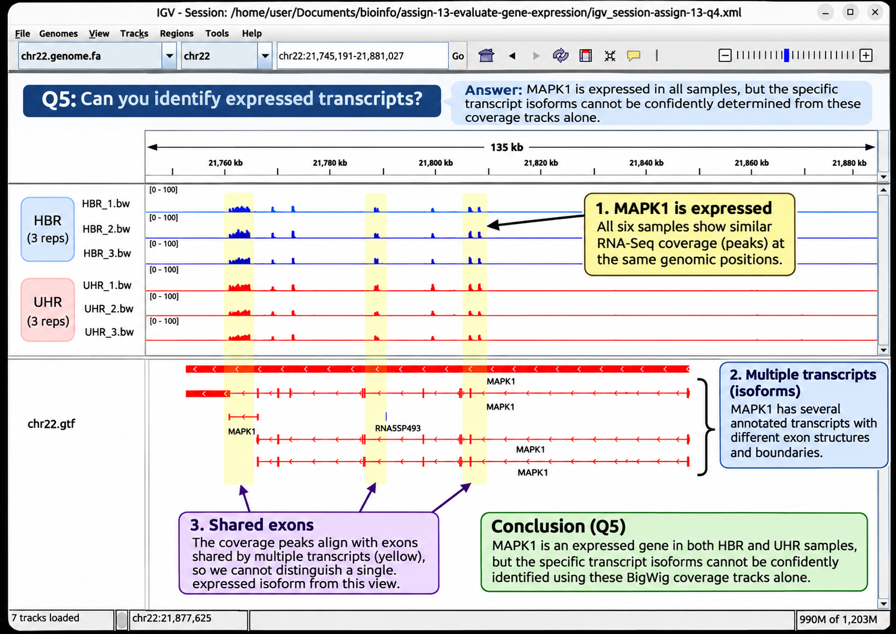
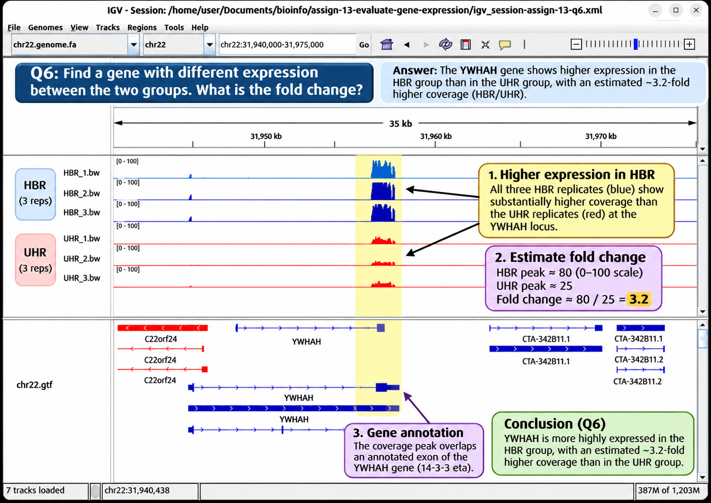
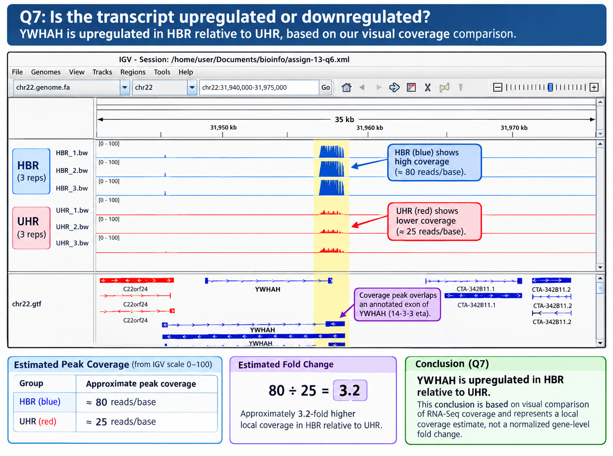
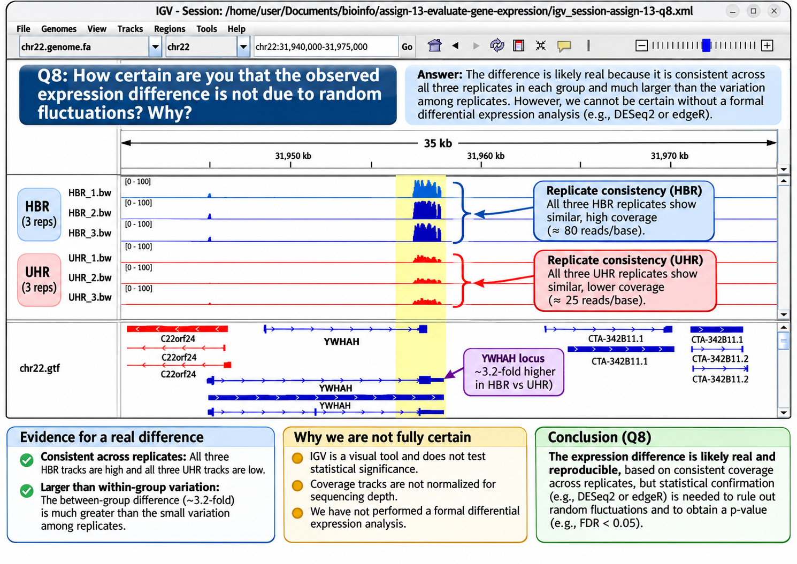

# Applied Bioinformatics 2026

## Week13 - Evaluate gene expression

## Introduction

### Evaluate gene expression

This assignment does not require writing code.

Use IGV to visualize the RNA-Seq alignments and coverages, then use your eyes to answer the questions.

Repeat the steps from Genome-based RNA-Seq and generate coverage files for all samples, as described there.

The samples are described on the RNA-Seq tutorial data page:

1. Universal Human Reference (UHR): RNA from a diverse set of 10 cancer cell lines.
2. Human Brain Reference (HBR): RNA isolated from human brains.

### The task

Visualize the coverage for all samples and the GTF file in IGV.

1. Load the chr22.genome.fa reference genome.
2. Load each of the coverage files for the samples.
3. Color samples by type, using the same color for replicates.
4. Load the gtf/chr22.gtf GTF file.

### The questions

1. Look at a wide region (millions of bases wide). How are the two sample types different?
2. Navigate across the genome. How consistent are the replicates?
3. Find a gene that is not expressed in any of the samples.
4. Find a gene that is very strongly expressed in all samples. What is its coverage?
5. Can you identify the transcripts that are expressed? Sometimes you can only exclude some candidates.
6. Can you find a gene/transcript where the expression is clearly different between the two sample types? What is the fold change?
7. Is the transcript upregulated or downregulated?
8. How certain are you that it is not a random fluctuation? Why?

### Analysis

View the makefile options:

```bash
make
```

```
#
# Genome-based RNA-Seq: Human Chromosome 22
#
# SAMPLE=HBR_1
# THREADS=4
# JOBS=2
# FASTA=fasta/chr22.genome.fa
# R1=fastq/HBR_1_R1.fq
# BAM=bam/HBR_1.bam
# BW=bw/HBR_1.bw
# COUNT=counts/HBR_1.txt
#
# make data
# make index
# make align
# make count
# make all
# make batch
# make igv
# make clean
#
```

View the commands for a single/default sample:

```bash
make all -n
```

```
curl -fL --retry 3 "http://data.biostarhandbook.com/data/rnaseq-tutorial-2026.tar.gz" | tar xzvf -
hisat2-build -p 4 "fasta/chr22.genome.fa" "fasta/chr22.genome.fa"
mkdir -p bam
hisat2 --threads 4 --sensitive \
        -x "fasta/chr22.genome.fa" \
        -U "fastq/HBR_1_R1.fq" | \
        samtools sort --threads 4 \
                --write-index -o "bam/HBR_1.bam"
mkdir -p counts
featureCounts \
        -T 4 \
        -a "gtf/chr22.gtf" \
        -s 2 \
        -o "counts/HBR_1.txt" \
        "bam/HBR_1.bam"
mkdir -p bw
bamCoverage \
        --binSize 1 \
        --numberOfProcessors 4 \
        -b "bam/HBR_1.bam" \
        -o "bw/HBR_1.bw"
```

View the design file for make batch:

```bash
xan view design.cs
```

```
Displaying 2 cols from 6 rows of design.csv
┌───┬────────┬───────┐
│ - │ sample │ group │
├───┼────────┼───────┤
│ 0 │ HBR_1  │ HBR   │
│ 1 │ HBR_2  │ HBR   │
│ 2 │ HBR_3  │ HBR   │
│ 3 │ UHR_1  │ UHR   │
│ 4 │ UHR_2  │ UHR   │
│ 5 │ UHR_3  │ UHR   │
└───┴────────┴───────┘
```

Run make batch to process all the samples:

```bash
make batch
```

Run make igv to view the results in IGV (IGV must be running)

```bash
make igv
```

```
echo "new" | nc -q 1 localhost 60151
OK
echo "genome /home/user/Documents/bioinfo/assign-13-evaluate-gene-expression/fasta/chr22.genome.fa" | nc -q 1 localhost 60151
OK
echo "load /home/user/Documents/bioinfo/assign-13-evaluate-gene-expression/gtf/chr22.gtf" | nc -q 1 localhost 60151
OK
OK
OK
OK
OK
OK
OK
```

### Results

Question 1: Look at a wide region (millions of bases wide). How are the two sample types different?

The HBR (human brain reference) and UHR (universal human reference) RNA-Seq samples exhibit distinct gene-expression patterns across the 10-million-base region of chromosome 22 (chr22:20,000,000-30,000,000). The three HBR replicates (blue) generally show fewer prominent coverage peaks, while the three UHR replicates (red) display numerous strong peaks, particularly between 22–24 Mb and near 28.8 Mb. Some regions exhibit coverage in both sample types, while others show substantially greater coverage in one group, suggesting differences in gene expression between brain tissue and the mixture of cancer cell lines. The coverage patterns are remarkably consistent among replicates within each group, supporting the reproducibility of these observations. However, because the BigWig coverage files were not normalized for sequencing depth and the displayed coverage range is limited to 0–10, differences in peak heights should be interpreted cautiously until examined at higher resolution.


Figure. RNA-Seq coverage comparison between HBR and UHR samples across chromosome 22. IGV visualization of the 20–30 Mb region showing three HBR replicates (blue) and three UHR replicates (red). Each coverage track uses the same displayed range (0–10), allowing visual comparison of expression patterns. The GTF annotation track identifies genes and transcript structures, with positive-strand features displayed in blue and negative-strand features in red. UHR samples exhibit several prominent coverage peaks that are weak or absent in HBR, while both groups demonstrate consistent patterns among their respective replicates.

Question 2: Navigate across the genome. How consistent are the replicates?

The three HBR (human brain reference) and three UHR (universal human reference) RNA-Seq replicates exhibit highly consistent coverage patterns across the 5-million-base region of chromosome 22 (chr22:30,000,000-35,000,000). Within each sample group, coverage peaks generally occur at the same genomic positions with similar relative heights, indicating good reproducibility. For example, near 31.0 Mb, all three UHR replicates display prominent peaks, while the HBR replicates show comparatively weaker coverage. Conversely, near 32.0 Mb, the HBR replicates exhibit strong peaks that are substantially smaller in UHR. Another prominent UHR peak occurs near 32.9 Mb, with relatively little corresponding HBR coverage. These consistent patterns suggest that the observed differences between sample groups are reproducible and may reflect genuine biological differences in gene expression rather than random fluctuations. However, visual consistency alone cannot establish statistical significance, and additional quantitative analysis would be required to confirm differential expression.


Figure. RNA-Seq replicate consistency across chromosome 22. IGV visualization of the 30–35 Mb region showing three HBR replicates (blue) and three UHR replicates (red). All six coverage tracks use the same displayed range (0–10). Coverage peaks occur at similar genomic positions within each sample group, demonstrating strong visual agreement among replicates. Notable differences between HBR and UHR are visible near 31.0, 32.0, and 32.9 Mb. The GTF annotation track below the coverage profiles identifies genes and transcript structures, with positive-strand features displayed in blue and negative-strand features in red.

Question 3: Find a gene that is not expressed in any of the samples.

The HORMAD2 gene, located on the positive strand of chromosome 22 at approximately 30.08–30.18 Mb, was identified as a candidate showing little or no detectable expression in either the HBR (human brain reference) or UHR (universal human reference) RNA-Seq samples. Examination of the six coverage tracks in IGV revealed essentially flat coverage across most of the annotated HORMAD2 exons, despite the presence of multiple transcript isoforms in the GTF annotation. A few isolated, low-coverage peaks were visible, particularly in the UHR samples, but these did not form a consistent expression pattern across the gene's exons. The observations suggest that HORMAD2 is either not expressed or expressed at levels below reliable detection in these samples. This illustrates that the presence of a gene in the reference genome does not necessarily mean it is actively transcribed under the biological conditions being studied.


Figure. IGV visualization of the HORMAD2 gene on chromosome 22 (chr22:30,050,000–30,200,000). The annotated image highlights the HORMAD2 region, approximately 30.08–30.18 Mb, and compares RNA-Seq coverage across three HBR replicates (blue) and three UHR replicates (red). All six coverage tracks display little or no substantial signal over the annotated exons, despite the presence of multiple HORMAD2 transcript isoforms in the GTF annotation. The scattered low-coverage peaks do not provide convincing visual evidence of substantial gene expression, making HORMAD2 a reasonable candidate for a gene with no detectable expression in this exercise.

Question 4: Find a gene that is very strongly expressed in all samples. What is its coverage?

The MAPK1 (mitogen-activated protein kinase 1) gene, located on the negative strand of chromosome 22 at approximately 21.75–21.87 Mb, was identified as a gene exhibiting substantial RNA-Seq coverage in all six samples. Examination of the three HBR (human brain reference) replicates and three UHR (universal human reference) replicates revealed prominent coverage peaks at consistent genomic positions, particularly near 21.76 Mb, corresponding to annotated MAPK1 exons. After adjusting the IGV coverage scale from 0–10 to 0–100, the approximate peak coverage was estimated at 20–25 reads per base for HBR and 15–20 reads per base for UHR. These values represent local peak coverage rather than average coverage across the entire gene. The consistent expression patterns suggest that MAPK1 is actively transcribed in both sample types, although differences in sequencing depth and the absence of coverage normalization limit quantitative comparisons between groups.


Figure. Annotated IGV visualization of MAPK1 expression across chromosome 22 (chr22:21,736,639–21,886,639). The highlighted region identifies the MAPK1 gene on the negative strand and compares RNA-Seq coverage across three HBR replicates (blue) and three UHR replicates (red). All six tracks use a coverage scale of 0–100, revealing prominent peaks near 21.76 Mb and additional peaks corresponding to annotated exons. Approximate peak coverage ranges from 20–25 reads per base in HBR to 15–20 reads per base in UHR. The consistent coverage patterns across all six samples provide visual evidence of MAPK1 expression in both biological groups.

Question 5: Can you identify expressed transcripts?

Examination of the MAPK1 gene on chromosome 22 (chr22:21,745,191–21,881,027) demonstrates that RNA-Seq coverage can identify an expressed gene but does not necessarily distinguish its individual transcript isoforms. All six samples, including three HBR (human brain reference) and three UHR (universal human reference) replicates, exhibit consistent coverage peaks at genomic positions corresponding to annotated MAPK1 exons. The GTF annotation displays several MAPK1 transcript isoforms with overlapping exon structures and different transcript boundaries. Because many of these transcripts share the same exons, the observed coverage could originate from multiple isoforms. Although coverage over unique exons or splice junctions could help distinguish transcripts, the BigWig tracks alone do not provide sufficient evidence to confidently identify or exclude specific MAPK1 isoforms. More detailed analysis of aligned reads or transcript-level quantification would be required to resolve their expression.



Figure. Annotated IGV visualization addressing Question 5: Can you identify expressed transcripts? The MAPK1 gene is displayed on chromosome 22 with three HBR replicates (blue) and three UHR replicates (red). Yellow highlights identify regions where RNA-Seq coverage peaks correspond to exons shared by multiple annotated transcripts. The GTF annotation illustrates several MAPK1 isoforms with overlapping exon structures. Although MAPK1 expression is evident in all six samples, the shared coverage patterns prevent confident identification of individual transcript isoforms using BigWig coverage alone.

Question 6: Find a gene or transcript where expression is clearly different between the two groups. What is the fold change?

The YWHAH gene, located on the positive strand of chromosome 22 near position 31,957,000, demonstrates a clear difference in RNA-Seq coverage between the HBR (human brain reference) and UHR (universal human reference) sample groups. Examination of all six replicates reveals consistently higher coverage in the three HBR samples (blue) than in the three UHR samples (red), with the prominent coverage peaks overlapping an annotated YWHAH exon. Using the common IGV coverage scale of 0–100, peak coverage was visually estimated at approximately 80 reads per base for HBR and 25 reads per base for UHR. Dividing these representative values (80 ÷ 25) gives an estimated fold change of 3.2, indicating approximately 3.2-fold higher local RNA-Seq coverage in HBR. The consistent differences across all three replicates in each group support a reproducible expression difference. However, because the BigWig tracks were not normalized for sequencing depth, this estimate represents a visual comparison of local coverage rather than a statistically validated gene-level fold change.



Figure. Annotated IGV visualization addressing Question 6: Find a gene or transcript where expression is clearly different between the two groups. What is the fold change? The YWHAH gene is displayed on chromosome 22 (chr22:31,940,000–31,975,000), with three HBR replicates (blue) and three UHR replicates (red). The yellow highlighted region identifies a prominent coverage peak overlapping an annotated YWHAH exon. HBR replicates consistently exhibit substantially greater coverage than UHR replicates. Representative peak values of approximately 80 and 25 reads per base yield an estimated 3.2-fold difference (HBR/UHR). This visual comparison demonstrates reproducible differences in local RNA-Seq coverage between the two sample groups.

Question 7: Is the transcript upregulated or downregulated?

The YWHAH gene on chromosome 22 exhibits higher RNA-Seq coverage in the HBR (human brain reference) samples than in the UHR (universal human reference) samples, indicating that YWHAH is upregulated in HBR relative to UHR. All three HBR replicates consistently show substantially greater coverage than the three UHR replicates at an annotated YWHAH exon near position 31,957,000. Using representative peak coverage values of approximately 80 reads per base for HBR and 25 reads per base for UHR, the estimated fold change is 80 ÷ 25 = 3.2. Thus, YWHAH exhibits approximately 3.2-fold higher local coverage in HBR compared with UHR. Conversely, YWHAH can be described as downregulated in UHR relative to HBR. The direction of regulation depends on which group is used as the reference. Because these samples represent different RNA sources rather than a before-and-after experiment, higher expression in HBR is the more precise interpretation. Furthermore, this conclusion applies to the YWHAH gene rather than a specific transcript isoform, and the estimated fold change is based on unnormalized local coverage rather than formal differential expression analysis.



Figure. Annotated IGV visualization addressing Question 7: Is the transcript upregulated or downregulated? The YWHAH gene is displayed on chromosome 22 (chr22:31,940,000–31,975,000), with three HBR replicates (blue) and three UHR replicates (red). The yellow highlighted region identifies a prominent coverage peak overlapping an annotated YWHAH exon. All three HBR replicates exhibit consistently higher coverage, approximately 80 reads per base, compared with approximately 25 reads per base in the three UHR replicates. The estimated 3.2-fold difference indicates that YWHAH is upregulated in HBR relative to UHR, or equivalently, downregulated in UHR relative to HBR. This interpretation is based on visual comparison of unnormalized RNA-Seq coverage and does not establish transcript-specific regulation or statistical significance.

Question 8: How certain are you that the observed expression difference is not due to random fluctuations? Why?

The observed difference in YWHAH expression between the HBR (human brain reference) and UHR (universal human reference) groups provides convincing visual evidence of a reproducible expression difference, although statistical significance cannot be established from IGV visualization alone. All three HBR replicates exhibit consistently high RNA-Seq coverage, with approximate peaks of 80 reads per base, while all three UHR replicates show substantially lower coverage, averaging approximately 25 reads per base. The estimated 3.2-fold difference in local coverage between groups is considerably greater than the apparent variation among replicates within each group, suggesting that the observed difference is unlikely to be explained solely by random fluctuations. However, the BigWig coverage tracks have not been normalized for sequencing depth, and visual comparisons cannot quantify biological variability or statistical uncertainty. A formal differential expression analysis using tools such as DESeq2 or edgeR would normalize gene counts, estimate variability among replicates, and calculate statistical significance using p-values and false discovery rate (FDR) adjustments. An adjusted p-value below 0.05 would commonly be considered evidence of statistically significant differential expression. Because this analysis has not been performed, no statistical significance can be assigned to YWHAH. Nevertheless, the consistency across all six replicates supports the conclusion that YWHAH exhibits a reproducible difference in RNA-Seq coverage between HBR and UHR.



Figure. Annotated IGV visualization addressing Question 8: How certain are you that the observed expression difference is not due to random fluctuations? Why? The YWHAH gene is displayed on chromosome 22 (chr22:31,940,000–31,975,000), with three HBR replicates (blue) and three UHR replicates (red). The yellow highlighted region identifies a prominent coverage peak overlapping an annotated YWHAH exon. All three HBR replicates exhibit similarly high coverage, approximately 80 reads per base, while all three UHR replicates consistently show lower coverage, approximately 25 reads per base. The estimated 3.2-fold difference between groups exceeds the apparent variation among replicates, providing visual evidence of reproducibility. However, because coverage has not been normalized and no statistical testing has been performed, the observed difference cannot be considered statistically confirmed. Formal differential expression analysis would be required to establish statistical confidence and distinguish biological differences from random variation.

## Summary

This exercise demonstrated how RNA sequencing (RNA-Seq) data can be used to investigate gene expression, compare biological samples, and identify potential differences in transcriptional activity. Using a reproducible Makefile workflow, RNA-Seq reads from three human brain reference (HBR) and three universal human reference (UHR) samples were aligned to the human chromosome 22 reference genome using HISAT2, processed with SAMtools, and converted into BigWig coverage tracks using deepTools. Gene annotations from a GTF file were used to interpret the results in the Integrative Genomics Viewer (IGV). Examination of all six samples revealed distinct expression patterns between the two groups while demonstrating generally consistent coverage among replicates. The HORMAD2 gene exhibited little or no detectable expression, whereas MAPK1 showed clear expression across all six samples. Examination of MAPK1 also illustrated the difficulty of distinguishing individual transcript isoforms when multiple transcripts share exons, emphasizing the limitations of coverage-based visualization. A particularly informative example was the YWHAH gene, which exhibited approximately 3.2-fold higher local RNA-Seq coverage in HBR than in UHR, with a consistent difference across all three replicates in each group. Although this observation suggests differential gene expression, the coverage tracks were not normalized for sequencing depth, and no statistical significance testing was performed. Consequently, the estimated fold change remains preliminary and would require validation using normalized gene counts and statistical methods such as DESeq2 or edgeR. Overall, the exercise reinforced the importance of reference genomes, gene annotations, biological replicates, and careful interpretation of RNA-Seq coverage. Most importantly, it demonstrated that visual inspection is a valuable exploratory tool for identifying candidate expression differences, but reliable conclusions about differential gene expression require quantitative analysis and statistical validation.